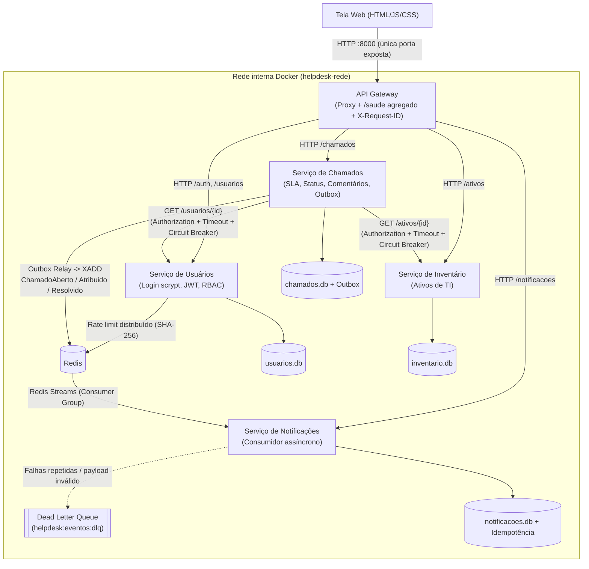

# HelpDesk TI · Arquitetura em Microsserviços

> **Vídeo de demonstração:** https://www.youtube.com/watch?v=0mys17eRyRk

Sistema de chamados de TI evoluído de um monólito FastAPI para uma **arquitetura em microsserviços desacoplada, resiliente e orientada a eventos**, mantendo todas as funcionalidades, regras de SLA e garantias de segurança do projeto original ([DESAFIO.md](DESAFIO.md)).

## Arquitetura atual (microsserviços)



## O que há de criativo e melhorias arquiteturais

1. **API Gateway como ponto único e observável (`servicos/gateway`):**
   - Único contêiner com porta publicada (`127.0.0.1:8000`).
   - Serve a interface web com CSP restrita e propaga `X-Request-ID` ponta a ponta e `X-Forwarded-For` real para rate-limit no serviço de Usuários.
   - Endpoint agregado **`GET /saude`** consulta concorrentemente os 4 microsserviços e exibe na própria interface web quais serviços estão `ok` ou `offline`, com latência em ms.
2. **Resiliência síncrona com Timeout + Retry seguro + Circuit Breaker (`servicos/chamados`):**
   - Chamadas HTTP a Usuários e Inventário têm `timeout` configurável (`HTTP_TIMEOUT_SEGUNDOS=2.5s`), 1 retry rápido apenas em `ConnectError` transitório e **Circuit Breaker por dependência** (`CLOSED` -> `OPEN` -> `HALF_OPEN`).
   - Se Inventário ou Usuários caírem, Chamados retorna **503 Service Unavailable** claro sem travar as demais rotas (listagem de chamados, painel e chamados sem equipamento continuam operando normalmente).
3. **Mensageria confiável com Transactional Outbox + Redis Streams + Idempotência + DLQ (`servicos/chamados` -> `servicos/notificacoes`):**
   - Ao abrir, atribuir ou resolver um chamado, o evento é gravado na tabela `outbox_eventos` **na mesma transação SQL** do chamado.
   - Um *relay* assíncrono envia os eventos ao **Redis Streams** (`helpdesk:eventos`). Se o Redis ou Notificações estiverem fora do ar, o chamado continua sendo salvo normalmente e os eventos pendentes são entregues assim que voltarem.
   - O serviço de Notificações consome em *Consumer Group* (`XREADGROUP` + `XAUTOCLAIM`), garante **idempotência** via tabela `eventos_processados` (`event_id` único) e move eventos inválidos/recorrentes para uma **Dead Letter Queue** (`helpdesk:eventos:dlq`).
4. **Rate-limit distribuído de login no Redis (`servicos/usuarios`):**
   - Resolve a limitação apontada no monólito: tentativas de senha erradas são contabilizadas no Redis usando hash **SHA-256** da chave `email|ip` (sem gravar PII em texto puro no Redis), com *fallback* automático para memória se o Redis ficar indisponível.
5. **Segredo compartilhado zero-hardcode (`init-segredo`):**
   - Nenhum segredo JWT é fixado no código. Se `JWT_SEGREDO` estiver definido no `.env`, todos os serviços o utilizam; caso contrário, no `docker compose up --build`, o contêiner inicializador `init-segredo` gera um segredo criptográfico aleatório em um volume montado como somente leitura (`:ro`) nos microsserviços.
6. **Painel Web evoluído dentro do mesmo design system:**
   - Barra ao vivo de **Saúde dos microsserviços** no topo do painel.
   - Modal acessível (**Detalhes**) com descrição completa, ativo vinculado e **histórico + envio de comentários**.
   - Seções colapsáveis por perfil para cadastrar **equipamentos** (`tecnico`/`admin`) e **usuários** (`admin`).
   - Atualização automática após 450 ms para refletir notificações processadas por consistência eventual.

## Decisões arquiteturais e trade-offs

| Decisão | Alternativa considerada | Por que escolhemos e qual o trade-off |
|---|---|---|
| **Gateway em FastAPI + `httpx.AsyncClient`** | Nginx estático | Permite agregar `GET /saude` com status por serviço, unificar cabeçalhos CSP/segurança, propagar `X-Request-ID` e retornar erros JSON padronizados (`503`/`504`) na mesma stack Python. Trade-off: um processo Python leve a mais em vez de proxy C nativo. |
| **SQLite isolado por serviço (4 volumes)** | 4 instâncias PostgreSQL | Mantém `docker compose up --build` leve, rápido e fiel ao projeto base com isolamento total de dados e zero chaves estrangeiras cruzadas; pode ser trocado por PostgreSQL apenas mudando `DATABASE_URL`. Trade-off: menor concorrência de escrita em SQLite do que PostgreSQL. |
| **Validação JWT stateless em cada serviço** | Chamada síncrona `/auth/introspect` ao `usuarios` em toda requisição | Evita que uma queda do serviço de `usuarios` derrube `inventario`, `chamados` e `notificacoes` em leitura. Trade-off: revogação imediata de usuário ativo depende da janela curta do token (`TOKEN_MINUTOS=60`), mitigada pela checagem em `/auth/eu`. |
| **Redis Streams + Outbox Pattern** | Chamada HTTP síncrona para Notificações ou RabbitMQ | Entrega o bônus com baixa pegada de memória (~15 MB no Redis), suporta persistência em fila, *Consumer Groups*, DLQ e ainda atende ao rate-limit distribuído do serviço de Usuários no mesmo broker. Trade-off: notificações aparecem com consistência eventual (~alguns milissegundos após a resposta do chamado). |

## Estrutura do repositório

```text
├── docker-compose.yml               # Orquestra init-segredo, redis, 4 microsserviços e gateway
├── .env.example                     # Variáveis de ambiente (JWT_SEGREDO, timeouts, circuit breaker)
├── ROTEIRO-VIDEO.md                 # Roteiro passo a passo para a gravação de 4 a 6 min
├── .github/workflows/testes.yml     # CI por serviço (pytest + pip-audit) + E2E com Redis real
├── tests/test_integracao_e2e.py     # Testes ponta a ponta subindo os 5 processos reais
└── servicos/
    ├── gateway/                     # API Gateway (:8000), UI estática e /saude agregado
    ├── usuarios/                    # Auth (/auth/*), Usuários (/usuarios/*) e rate-limit Redis
    ├── inventario/                  # Equipamentos (/ativos/*)
    ├── chamados/                    # Chamados, SLA, comentários, clientes HTTP e Outbox
    └── notificacoes/                # Consumidor Redis Streams, idempotência, DLQ e GET /notificacoes
```

## Como rodar

### 1. Subir tudo com um único comando (Docker)

Opcionalmente copie `.env.example` para `.env` e defina um `JWT_SEGREDO` próprio (se não criar `.env`, `init-segredo` gera automaticamente uma chave aleatória compartilhada na primeira execução):

```bash
docker compose up --build
```

Em seguida confira todos os contêineres saudáveis (note que só o `gateway` publica a porta `8000`):

```bash
docker compose ps
```

Acesse:
- **Tela do HelpDesk TI:** http://localhost:8000
- **Saúde agregada dos microsserviços:** http://localhost:8000/saude
- **Documentação Swagger do Gateway:** http://localhost:8000/docs

### 2. Contas de exemplo (`DADOS_EXEMPLO=1`, senha padrão `Helpdesk2026`)

| E-mail | Perfil | Permissões |
|---|---|---|
| `admin@empresa.com` | Administrador | Tudo, inclusive cadastrar usuários |
| `carla@empresa.com` | Técnica | Ver todos os chamados, atribuir, resolver e cadastrar equipamentos |
| `diego@empresa.com` | Técnico | O mesmo que a Carla |
| `ana@empresa.com` | Solicitante | Abrir chamados, fechar/reabrir os próprios e ver só os seus |
| `bruno@empresa.com` | Solicitante | O mesmo que a Ana |

### 3. Rodar um serviço sozinho (sem depender dos demais)

Cada pasta em `servicos/*` é um projeto completo e independente:

```bash
cd servicos/inventario
pip install -r requirements-dev.txt
uvicorn app.main:app --port 8002
```

### 4. Executar os testes

Testes unitários e de segurança de cada serviço:

```bash
cd servicos/usuarios && pytest -q
cd servicos/inventario && pytest -q
cd servicos/chamados && pytest -q
cd servicos/notificacoes && pytest -q
cd servicos/gateway && pytest -q
```

Testes de integração ponta a ponta (subindo os 5 processos em portas isoladas):

```bash
pip install -r requirements-dev.txt
pytest -q
```

## Segurança

Todas as proteções do monólito foram preservadas e estendidas para fronteiras distribuídas. Veja os detalhes em [SECURITY.md](SECURITY.md).
